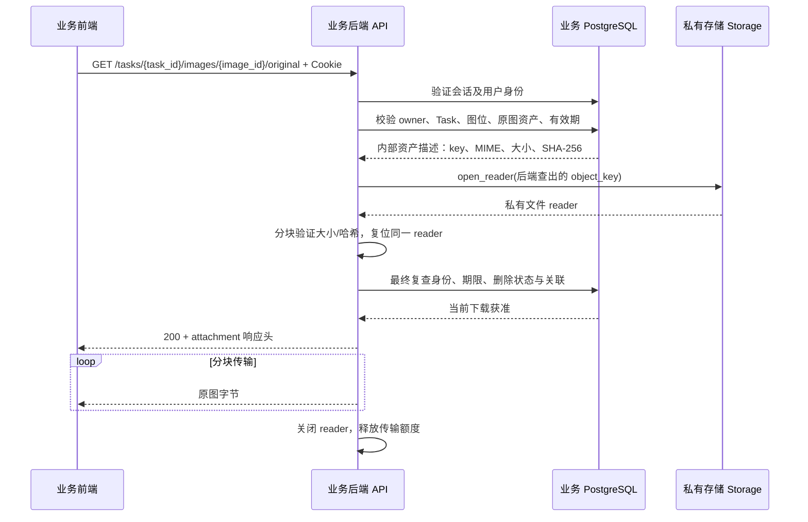

# 下载原图接口补充：后端实施文档

版本：v1.0。日期：2026-10-11（Asia/Shanghai）。

状态：需求与实施设计，尚未编码或验收。本次仅编写补充文档，不修改业务代码、原 Compose、环境凭证、Dify 配置或运行服务。本功能是当前后端接口合同的新增项，不能将现有“Worker 保存原图”或“用户预览图片”视为已经实现用户下载原图。

## 1. 目标与已确认规则

业务前端为用户已生成的图片提供“下载原图”操作。用户请求必须先经过业务后端的会话、用户归属、任务有效期和图片关联校验，再由后端从私有存储读取原图，返回图片字节给前端。

2026-10-11 用户已确认：

| 规则 | 本版本要求 |
|---|---|
| 下载范围 | 仅单张原图，使用 task_id 和 image_id；不提供任务 ZIP、批量打包接口 |
| 部分完成 | 任务仍在生成或部分失败时，已成功保存的单图允许下载，与现有预览的逐图交付原则一致 |
| 下载期间到期/删除 | 已通过最终校验并进入传输的下载允许完成；到期或进入删除流程后，拒绝新下载 |

沿用项目既有规则：访客会话是有效身份；身份由后端 Cookie 会话识别，不接受前端自报 user_id；任务保留期独立于访客会话期限。下载不延长任务有效期，不触发生图、不新增 attempt、不重放供应商请求、不扣费。

“原图”在本接口中指数据库 `ImageAsset.asset_kind = generation_original` 所对应的、后端已私有保存并提交关联的不可变文件。它不是用户上传的参考源图，也不是生成预览图，更不是临时供应商 URL 所指向的待下载结果。本接口返回该资产现有字节，不再压缩、转码、放大、去水印或重新生成；不承诺它与供应商最初响应在所有保存流程中未经任何处理。

## 2. 当前能力与补充边界

| 层次 | 当前能力 | 本次补充 |
|---|---|---|
| 身份 | `require_principal` / `AuthService` 验证会话、用户 active、撤销和期限 | 复用；传输前再次确认身份仍有效 |
| 任务 | `Task.owner_user_id`、`expires_at`、`status` | 复用；不新增客户端可指定的归属或期限 |
| 图位 | `TaskItem.status`、`image_id` | 只交付 succeeded 且已提交结果关联的图位 |
| 结果 | `GenerationResult` 关联任务、图位、attempt、owner、original/preview asset | 精确定位当前图位已公开的原图资产 |
| 资产 | `ImageAsset` 存储 kind、object_key、MIME、大小、尺寸、SHA-256、owner | 在后端内部使用，不返回 object_key |
| 存储 | `Storage.open_reader`，当前使用 `LocalPrivateStorage` | 从同一打开的 reader 验证大小/哈希，并传输同一 reader |
| API | `GET /api/v1/tasks/{task_id}/images/{image_id}/preview` | 新增同级 `/original` 下载路由 |
| 前端 DTO | `TaskItemResponse` 有 image_id/status/preview_ready/尺寸 | 首版维持任务 JSON v2，不强制新增 download_url 或 signed URL |

当前 `open_preview` 查询有 owner、任务期限和成功图位保护，但返回预览文件；它没有原图下载合同，也没有下载前完整 SHA 校验。实施时复用其关联和授权原则，不直接复制它就宣称原图完整性已校验，也不顺带改动预览接口行为。

首版复用现有数据模型，预计不需要 Alembic 迁移，不增加持久下载任务、RabbitMQ 事件或下载凭证表。若实现期间发现必须新增字段或改变清理合同，应先说明原因并调整本方案，不能顺手扩展生图流程。

## 3. 项目流程与信任边界

生成交付流程保持现有 H7/Worker 合同：生图结果由后端 Worker 私有保存，原图/预览资产、GenerationResult、TaskItem/attempt 关联提交后，前端才能取得成功图片标识。本功能仅从已经提交的结果开始。



前端只连接业务后端；数据库、存储根目录、对象 key、供应商 URL、Dify 凭证和服务间 bearer 都不进入公开响应。不能改成浏览器直连私有存储，不能返回 302 跳转到对象路径或生图服务，也不能用公开静态目录代替鉴权路由。

## 4. API 合同

### 4.1 请求

```http
GET /api/v1/tasks/{task_id}/images/{image_id}/original
Cookie: <现有 HttpOnly 会话 Cookie，由浏览器自动携带>
```

- task_id、image_id：UUID，使用现有任务响应中的 task_id 和 items[].image_id。
- 无请求 body，无业务 query 参数；不接受 user_id、owner、object_key、文件路径、供应商 URL、token 或用户自定 filename。UUID 非法沿用当前 422 校验响应；未知业务参数/非空 body 用 400 REQUEST_INVALID 拒绝。
- 不新增浏览器可持有的长期 bearer。生产沿用 HTTPS/Secure 会话，本地测试沿用明确的开发 Cookie；不改变项目已有生产门禁。
- GET 本身不刷新访客会话、任务 updated_at 或任务保留期。用户主动点击下载时，前端可按既有会话流程显式 refresh **仍有效**的访客会话；失效会话不能靠下载恢复，重新建立访客也不获得旧用户的资源。
- 沿用同域 Vue/API 的既有只读请求认证。会话 Cookie 与用户归属是核心授权依据，Referer/Origin 不能替代它们；首版不要求普通同域 GET 必须携带 Origin，不更改全局 CORS/CSRF 合同。
- 路由沿用 tasks API 现有注册开关，不新增独立“绕过 tasks gate”的下载入口。服务未开启时不会注册此路由。

### 4.2 成功响应

返回 200，body 为原图二进制，不包成 JSON，不使用 Base64。

```http
HTTP/1.1 200 OK
Content-Type: image/png
Content-Disposition: attachment; filename="task_<task-uuid>_image_<image-uuid>.png"
Content-Length: <已验证的真实字节数>
Cache-Control: private, no-store
X-Content-Type-Options: nosniff
X-Request-ID: <请求 ID>
Accept-Ranges: none
```

| 字段 | 实施要求 |
|---|---|
| Content-Type | 取数据库经验证的原图 MIME，仅接受当前 JPEG、PNG、WebP 白名单 |
| Content-Disposition | attachment；服务端生成 ASCII 文件名，不拼用户商品名/任意参数；jpg/png/webp 扩展名由固定 MIME 映射产生 |
| Content-Length | 实际读取并验证的大小，与数据库 size_bytes 一致；不是猜测大小或前端传入值 |
| Cache-Control | private, no-store；错误响应沿用全局 no-store |
| X-Content-Type-Options | nosniff |
| X-Request-ID | 沿用现有中间件；错误 JSON 中 request_id 与响应头一致 |
| Accept-Ranges | none；首版不支持断点续传，不承诺 HEAD 下载合同 |

首版收到 Range 时仍完整鉴权和完整校验，忽略 Range 返回完整 200，不返回未经实现的 206，也不把“不支持 Range”错误写成“范围不可满足”的 416。此选择符合 [RFC 9110 §14.2–14.3](https://www.rfc-editor.org/rfc/rfc9110.html#section-14.2)。后续若增加 Range，须单独定义每次范围请求的授权、期限与完整性合同。

attachment/filename 按 [RFC 6266](https://www.rfc-editor.org/rfc/rfc6266) 构造。当前 ASCII 命名不需要 filename*；未来如采用中文友好文件名，应同时提供合法 ASCII fallback 与标准 UTF-8 filename*，不能直接拼未经处理的字符串进响应头。

不提供共享 URL、下载 token、对象地址、提示词、参考图、内部清单或供应商 job 元信息。SHA-256 首版用于服务端核验与验收，不要求增加公开摘要头。

首版不对图片响应增加 gzip 等内容编码，业务反向代理也须透传已经验证的图片字节及 Content-Length，不进行压缩/转码。前端示例按原图字节数判断完整性，因此代理联调必须包含这一项；不能忽略透明解码后 Blob 大小与压缩后的传输长度可能不同的情况。

### 4.3 错误响应

沿用 `{code, message, request_id}`，新增错误码先同步接口合同和前端处理；下表是本补充的目标合同，不表示当前代码已注册这些码。

| 状态 | code | 场景 |
|---|---|---|
| 401 | AUTH_REQUIRED（已有） | Cookie 缺失、错误、撤销、到期，用户 inactive，或最终身份复查失败 |
| 400 | REQUEST_INVALID | 未知业务 query 参数或非空请求 body |
| 422 | HTTP_ERROR（当前全局校验行为） | task_id/image_id 不是合法 UUID；不新增另一套 UUID 错误 DTO |
| 404 | ORIGINAL_NOT_FOUND | task/image 不存在、跨 owner、错任务关联、图位未成功、错误 asset kind、任务已到期/删除/不存在，或最终关联复查失败 |
| 503 | DATABASE_UNAVAILABLE | 身份以外的任务/资产查询不可用；身份数据库故障亦需沿用 AuthService 的已有安全错误处理 |
| 503 | ORIGINAL_UNAVAILABLE | 已授权资产的文件缺失、不可打开/读取、reader 不能满足当前读取合同、非法存储 key 等存储故障 |
| 503 | ORIGINAL_INTEGRITY | 资产大小、SHA-256、MIME、读取上限或不可变资产描述不符合合同 |
| 503 | DOWNLOAD_BUSY | 下载并发额度不足或传输前准备超时，可带 Retry-After |
| 500 | HTTP_ERROR（已有全局兜底） | 未预期内部异常，不输出异常正文或存储路径 |

文件缺失与损坏只在已证明 owner/任务关联后给出安全故障码；其他用户始终不能用错误差异探查原图存在性。原图接口到期返回统一 404，与现有 preview 一致；现有任务详情接口 `TASK_EXPIRED/410` 保持原合同，不为本次补充改掉它。

200 响应开始后出现磁盘读取错误、断线或超时，不能再发送第二个 JSON 错误响应或将图片尾部追加 JSON。关闭连接/结束传输，关闭 reader，记录安全失败原因；前端将不完整下载视为失败。不能为了补齐原图重新触发生图。

## 5. 会话、归属和有效期校验

### 5.1 校验来源和时钟

身份取自现有 `require_principal`，得到服务器认证的 user_id/session_id。会话验证沿用 AuthService，不能仅凭 session_id 由前端传入就可信。任务期限使用 PostgreSQL 当前时间判断，不接受客户端时间，不重新按全局“60 天”计算已有任务。

需验证的关联：

```text
已认证当前用户
  └─ Task.id = task_id，Task.owner_user_id = 当前用户
      └─ TaskItem.task_id = Task.id，status = succeeded
          └─ TaskItem.image_id = 请求 image_id
              └─ GenerationResult.task_id / task_item_id / owner_user_id 完全相符
                  └─ GenerationResult.original_asset_id = 请求 image_id
                      └─ ImageAsset.id / owner_user_id / kind=generation_original 完全相符
```

GenerationResult.attempt_id 还必须指向该图位的已完成 attempt；不能把另一个图位/历史不关联 attempt 的 asset 拼进来。使用固定 ORM/Core 关联与参数绑定，禁止字符串拼 SQL。

### 5.2 允许下载的条件

1. 会话仍有效、未撤销，用户 active。
2. 任务归属匹配，未进入 deleting，也未物理删除。
3. `expires_at IS NULL OR expires_at > 数据库当前时间`；到期时点相等也拒绝。
4. 当前图位 succeeded，有已经提交的 GenerationResult/原图资产关联，所有 owner/task/item/attempt/image 关系匹配。
5. 原图资产 MIME、大小和摘要元信息合法，私有文件的实际大小/哈希与记录一致。

父任务不要求整体 succeeded。父任务 generating/reconciling/partially_succeeded 时，满足上述条件的已成功单图可以下载。活动任务可能尚无 expires_at，不能把 NULL 一律判为过期，也不能借 NULL 放过未成功/未关联资产。

不以 preview_ready 为原图读取的额外门槛；它是预览能力字段。但这不放宽现有 Worker 的完成规则：仅有原图落盘、没有成功图位或资产事务未提交时，仍不可下载。原图与预览的数据库保存/图位成功提交方式保持现行合同。

image_id 已经标识该成功图位公开的原图资产；不得再把它当 preview asset_id。请求直接传 preview/reference asset_id 必须 404，即使这些资产属于同一用户。

不以生图许可到期、Dify 临时 URL 到期或服务源文件到期代替 Task.expires_at。生成已完成且原图已私有保存后，本接口不依赖上游许可/URL 继续有效。

## 6. 从私有存储到 HTTP 的实施步骤

### 6.1 服务边界

建议新增 `TaskService.open_original(...)` 与内部 `OriginalDownloadStream` 返回类型。返回类型携带 reader、经核验 MIME/size、服务端 filename、close 责任；数据库 key、内部关联快照等仅留在后端，不序列化进公开 DTO。

实现顺序：

1. 会话认证与下载准入额度检查。先拒绝未认证请求，再执行磁盘完整性扫描，防止匿名请求耗费文件 I/O。
2. 在短数据库查询中按第 5 节定位原图，读取不可变资产快照与期限；关闭 Session，不能在读整个文件或客户端慢下载期间持有事务/行锁。
3. 使用 **数据库查出的 key** 调用 `Storage.open_reader`，而不是拼路径或解析客户端 URL。
4. 对该 **同一打开的 reader** 以有界块读取计算实际大小和 SHA-256；核对数据库元信息。当前复用 `generation_image_saving.MAX_GENERATION_IMAGE_BYTES = 32 MiB` 上限，不建立比写入端更小的任意下载上限；超上限作为数据完整性/合同故障，不向前端放行。
5. reader 复位到 0。当前 LocalPrivateStorage 是可 seek 的普通文件；若适配器不具备此能力，不假装支持，返回安全 unavailable。未来要支持其他 reader，需明确有界临时文件快照合同，不能把任意大小文件一次性读入内存。
6. 发送响应前，以新的短数据库授权检查复核会话有效性、owner、任务期限/删除状态、当前图位关联及原图快照未改变。认证规则复用 AuthService 的共同逻辑；不得在 TaskService 另写一份与会话规则可能漂移的授权算法。必要时新增服务端内部会话复核辅助函数，输入只来自已认证 Principal。
7. 最终授权成功后立刻进入响应发送，将已经打开、校验并复位的 **同一 reader** 交给响应层，分块输出，结束后关闭 reader 并释放额度。

不得先 `Storage.stat(key)` 校验某个文件，再按相同路径重新打开另一份文件并直接传输，这会留下“检查对象与实际发送对象不同”的窗口。当前 `LocalPrivateStorage.stat` 虽会算 SHA，但与后续 open_reader 是两次独立打开，不能单独作为本接口已经锁定发送对象的证据。

内容校验在服务端 reader 上完成，不要求再次 Pillow 解码/重新保存图片；保存阶段已经验图。MIME 白名单、大小上限和 SHA 校验不可省略。不可变对象合同成立时，两次读取同一 reader 返回同一资产；不把此机制宣称为能抵御外部管理员原地改写文件的快照保证。

### 6.2 生命周期和资源关闭

采用固定大小块（建议 128 KiB）和流式响应；整个响应不得以单个 bytes/Base64 常驻 API 内存。同步磁盘扫描、读取和关闭应使用适合现有 FastAPI 同步/线程池架构的方式，不能在 async 事件循环中直接进行长时间同步读取。

close 必须覆盖：校验失败、复位失败、数据库复查失败、响应构造失败、响应从未开始迭代、正常 EOF、客户端断线、超时和协程取消。建议用具备响应级 try/finally 的专用 StreamingResponse 包装，close 幂等；不能只依赖“生成器正常跑完”的 finally，也不能只依赖 BackgroundTask，避免断线或尚未迭代时泄露描述符。

计数器/并发额度同样在上述所有路径只释放一次。读取长度必须与 Content-Length 一致，传输不足/超出不得记为成功。Header 发出之前的故障返回 JSON；之后的故障走流终止及安全日志。

同步准备操作进入工作线程后，异步请求取消并不自动终止该线程。需通过协作取消标志/截止时间在块间停止，明确 reader 和额度的所有权；工作线程仍在读时，不能由另一线程关闭 reader 或提前释放额度后放入新扫描。超时包装本身不等于能强制中断底层磁盘调用，此行为要用取消/并发测试验证。

### 6.3 到期、删除与下载竞争

本接口的授权准入时点定义为：完成文件完整性准备后，最终数据库校验确认该请求仍可读取，随即交给 HTTP 响应发送。这个最终检查是请求的授权判定点；不宣称数据库查询与物理网络首字节是同一个原子操作。

| 竞争时序 | 要求 |
|---|---|
| 初始查询前已经到期/删除 | 404，不打开文件 |
| 初始查询有效，清理先删除文件，再打开 | 返回安全 unavailable，不重新生成、不绕到供应商读取 |
| 文件已打开/校验，但最终复查发现到期/删除 | 404，关闭 reader，不发送图片 body |
| 最终授权已成功进入传输，随后到期/删除 | 已获准的流允许完成；后来新请求 404 |
| 最终授权已成功进入传输，随后会话撤销/过期 | 对已准入的同一响应采用相同规则；新请求重新认证并拒绝 |
| 下载期间浏览器主动断线 | 尽快终止读流并释放 reader/额度，不能当作任务失败或触发生图 |

当前部署目标是 Docker 内 Linux LocalPrivateStorage：打开的普通文件 reader 在路径被 unlink 后可以继续读取已有描述符。必须通过隔离环境清理并发测试证明该行为与当前适配器兼容，不能仅以“文件已打开”口头判定成功。为保持现有清理流程，不因用户慢下载持有长数据库锁、不延长任务 expires_at、不阻止已经到期任务接受新请求的拒绝。

描述符未关闭时，文件可能已从目录删除但磁盘空间尚未完全释放；这是已准入下载完成的必要生命周期，不是延长公开访问期。设置有限传输时长，避免无期限保留资源。其他存储驱动或原生 Windows 文件语义未在本版承诺范围；若不能保证既有 reader 持续读，需要先定义和验证有界快照机制，而不是擅自改清理期限或新增长期下载租约。

## 7. 性能、限流与日志

整文件 SHA 预检增加一次磁盘读取，之后传输再读一次；不得承诺首字节延迟与现有预览完全一样。先用隔离的最大 32 MiB 文件测量耗时、内存、并发与断线资源释放。

建议新增两个可验证的后端配置（名称采用既有 IMAGE_BACKEND_ 前缀）：

| 配置 | 建议初值 | 边界 |
|---|---|---|
| ORIGINAL_DOWNLOAD_MAX_CONCURRENT | 4 | 每 API 进程的准备+传输总并发，必须正整数；不能误称全局或每用户限额 |
| ORIGINAL_DOWNLOAD_TIMEOUT_SECONDS | 120 | 单次准备+传输的有限时间预算；从获取额度起计时，慢下载超时按流终止规则处理 |

额度不可用时立即返回 DOWNLOAD_BUSY/503 与短 Retry-After（例如 5 秒），不排无限等待队列；实现需在取消/断线路径释放额度。这两个初值属于待性能验收的工程配置，不是已承诺吞吐量。多个 API 进程的总额度相加；若将来要求跨进程、跨副本的用户限流，另用项目统一机制，不在本接口临时新增 Redis 等基础设施。

只记录 request_id、阶段、HTTP 状态、安全原因码、耗时、实际发送字节及必要的 task/image 标识；用户/会话标识遵循现有日志最小化规范。不得记录 Cookie、bearer、object_key/绝对文件路径、供应商 URL、SQL 参数、提示词或原始图片内容。

成功统计区分“获准/响应开始”“传输完成”“流中断”；不能把 200 Header 已发出当作前端成功保存文件。服务端也不能证明用户在浏览器保存对话框中最终点击了保存，不新增所谓可靠下载次数/计费记录。

## 8. 业务前端对接

首版 Vue 的按钮显示条件为该 item.status=succeeded 且 image_id 非空；这是界面提示，不是授权。不能依赖 preview_ready 去决定原图是否可读，也不能因为前端尚未隐藏按钮而绕过后端到期检查。

建议沿用同域 fetch，携带 Cookie，在收到成功后才生成 Blob 下载；错误状态先解析项目 JSON 错误，不把 401/404/503 的 JSON 保存为“图片”。示意代码：

```ts
async function downloadOriginal(taskId: string, imageId: string) {
  const url = `/api/v1/tasks/${encodeURIComponent(taskId)}`
    + `/images/${encodeURIComponent(imageId)}/original`;
  const response = await fetch(url, { credentials: "include" });
  if (!response.ok) {
    const error = await response.json();
    throw error; // 交给既有 code/message/request_id 错误处理器
  }
  const blob = await response.blob(); // 截断/网络故障必须走下载失败处理
  const mimeExtensions: Record<string, string> = {
    "image/jpeg": "jpg", "image/png": "png", "image/webp": "webp",
  };
  const mime = response.headers.get("content-type")?.split(";")[0].trim();
  const ext = mime && mimeExtensions[mime];
  if (!ext) throw new Error("下载响应类型无效");
  const length = response.headers.get("content-length");
  if (length === null || !/^\d+$/.test(length) || blob.size !== Number(length)) {
    throw new Error("下载文件不完整");
  }
  const objectUrl = URL.createObjectURL(blob);
  try {
    const anchor = document.createElement("a");
    anchor.href = objectUrl;
    // 仅使用已验证 UUID 与固定 MIME 映射，和后端文件名合同一致。
    anchor.download = `task_${taskId}_image_${imageId}.${ext}`;
    document.body.appendChild(anchor);
    anchor.click();
    anchor.remove();
  } finally {
    // 在触发下载后延迟释放，并在目标浏览器验证实际行为。
    setTimeout(() => URL.revokeObjectURL(objectUrl), 30_000);
  }
}
```

该片段为联调示意，不替代真实前端组件、按钮防重复、取消控制、会话跨标签页锁和浏览器测试。Blob 会占用浏览器内存，服务端流式不代表前端零缓冲；首版单图最大 32 MiB，不做多张同时预取。不使用 localStorage 保存凭证，也不将 Cookie 放进 URL。

401 提示身份失效；404 提示图片已不可用；503 允许用户稍后重试 **同一下载接口**。重试下载不能调用任务 retry/create 或供应商生图入口。任务仍在生成时只为已成功图位提供下载按钮，失败图位的“重试生成”与“重新下载”必须是不同操作。

同域首版不需要新 CORS 设置。若将来改为前后端不同 origin，应另行配置受信 origin、credentials 以及需要读取的下载响应头，不能使用任意 origin 携带凭证。

## 9. 代码实施位置与阶段

| 文件/层 | 预计修改 |
|---|---|
| `backend/app/api/tasks.py` | 新增 `/original` GET，复用 principal/storage，参数合同和响应 Header |
| `backend/app/services/tasks.py` | 新增 open_original；固定关联、有效期、原图描述和最终复查 |
| `backend/app/services/auth.py`（必要时） | 为最终会话复查提取共用规则，原认证/续期行为不变 |
| 新增下载 stream/response 辅助模块 | 有界 reader 校验、幂等 close、超时/并发额度、流生命周期；避免继续膨胀任务状态机 |
| `backend/app/core/config.py` | 两项工程配置校验，保留当前 production/local 禁止规则 |
| 单元/PG/HTTP 验收文件 | 第 10 节矩阵，使用当前修复后的源码和独立 mock 环境 |
| `backend/docs/openapi.json`、Vue 接口合同 | 补充二进制响应与错误码，保留已有 task JSON v2 |
| 独立本地部署与验收包 | 如采用两项配置，显式传入 API；镜像版本/源码清单重发后，复验原图下载 |

阶段 A：将本补充作为新增接口合同，锁定用户已确认的三项规则，确认 error/headers/截止时点与现有版本相容。

阶段 B：实现服务与 response 生命周期，再补路由；尽量不改 Storage 公共协议、不改数据库/队列/生成流程。不要顺手把预览接口升级为另一套合同。

阶段 C：按单元 → 新 PostgreSQL 关联测试 → mock HTTP 全链路 → 重启/清理竞争 → 配套备份恢复进行验收。当前叠加故障 retry 修复必须保留，不能使用历史归档期待已消解 unknown 仍 409 的旧断言。

阶段 D：更新公开接口文件、Vue 联调说明、部署源包/固定镜像与验收报告。既有“原图 API 未实现”的报告保留历史日期和结论；新报告记录补充后的通过证据，不能追改旧报告假称它当时已通过。

## 10. 测试与验收矩阵

所有 PG/HTTP/重启/删除/备份恢复测试使用全新项目名、端口、网络、数据库、RabbitMQ 与私有卷，明确 mock 流程；不启停现有业务/Dify 容器，不连接原数据库/队列/卷，不调用真实 Dify、供应商或付费模型。代码修改实施需要新的任务授权，本轮文档不等于已执行上线。

| 编号 | 场景 | 必须观察到的结果 |
|---|---|---|
| O01 | owner 下载成功图位原图 | 200，body 大小/SHA 与 generation_original 记录和私有对象相符 |
| O02 | PNG/JPEG/WebP | MIME、扩展名、attachment、Content-Length 正确；不转码 |
| O03 | 缺失/错误/过期/撤销 Cookie、inactive user | 401，不读取私有文件内容 |
| O04 | 另一个 owner 猜中 task/image ID | 404，不读对象、不泄露存在性 |
| O05 | 同用户错 task、错图位/attempt 关联 | 404 |
| O06 | preview/reference asset ID 替代原图 ID | 404，不下载其他种类文件 |
| O07 | 成功单图 + 父任务仍生成/部分失败 | 成功图可 200；未成功图不可交付 |
| O08 | 原图只落盘，资产/结果事务未提交或回滚 | 404，不通过路径扫描绕过数据库 |
| O09 | 任务已到期、等于到期时点、deleting、物理删除 | 新请求 404；任务详情原 410 合同不回归 |
| O10 | 活动 Task.expires_at=NULL，已成功图位 | 可读；NULL 不绕过其他校验 |
| O11 | 已授权记录但对象缺失/读失败/非法 key | 503 安全码，无路径或异常正文 |
| O12 | 大小/哈希被破坏，元信息 MIME 非法 | 响应开始前 503，无图片 body |
| O13 | 同一个 reader 的校验与发送 | 确认未重新按路径 open；替换路径不能让发送未经校验对象 |
| O14 | 文件准备时会话撤销/任务到期/删除 | 最终复查拒绝，关闭 reader，不发成功图片 |
| O15 | 已进入传输后到期/删除，并发新请求 | 既有流按确认规则完成，新请求拒绝；实际调用清理路径验证 FD 行为 |
| O16 | 正常结束/响应未迭代/取消/断线/超时 | reader 与并发额度全部释放；重复关闭无异常 |
| O17 | 流中发生磁盘错误或截断 | 连接/读流失败，不拼接 JSON，不统计为传输成功 |
| O18 | 最大 32 MiB 与超界/零字节 | 合法上限图片可读；零/超界合同故障拒绝；内存随块/并发有界 |
| O19 | Range 请求、条件缓存探测 | Range 返回经过鉴权的完整 200；不绕权产生 206/缓存 304 |
| O20 | UUID 非法、注入字符串、未知业务参数、非空 body | 422/400 合同一致，无 SQL 拼接或路径注入 |
| O21 | 多个同时下载、额度耗尽、慢连接 | 有界并发/超时/安全 busy，拒绝或结束后额度恢复 |
| O22 | 反复下载/前端重试 | task/attempt/action/outbox/mock submit/billing/有效期不增加或变化 |
| O23 | API/Worker/DB/队列重启 | 原身份与已保存图片关联不变，原图 body 大小/SHA 不变 |
| O24 | DB + 私有图配套备份，恢复至另一新实例 | 全部关联与文件校验通过，再用原 cookie 下载原图和预览；不同 owner 仍拒绝 |
| O25 | tasks gate 关闭与 production local 门禁 | 无绕过路由；生产限制保留 |
| O26 | Vue 错误 JSON、截断、用户取消、文件名与下载 | 错误不存为图片，正确文件可保存、按钮恢复，Cookie 不进入日志/URL |

再运行与本修改有关的现行配置、会话、任务、retry-policy、存储、预览与清理回归。不能把 mock 全链路通过表述为真实 Dify/供应商或生产发布通过。

证据应保存：源码版本/哈希、固定镜像 ID、独立资源清单、当前唯一迁移 head、JUnit/HTTP 断言、原图与预览 asset 关联和 SHA/大小、清理竞争时序、断线资源关闭结果、恢复后实际 HTTP 读取、原服务保留核查及本轮服务停止记录。不得将明文 Cookie、数据库/队列密码放进公开报告。

## 11. 发布、回退与完成判据

本次是加法接口。原任务 JSON、预览路径、生成/回调/重试/清理合同保持兼容；无需搬移已有原图，不因新增下载功能重新生图或改写历史资产。

开发、测试和交付阶段先使用现有 LocalPrivateStorage、PRODUCTION=false、同一实例 `/data/private` 持久卷。API 必须能读取 Worker 保存的同一卷，不得落回临时目录。没有授权时不新增云存储、不修改原 backend/compose.yaml 或 Dify。

无数据库迁移时回退只需回到原 API 镜像并隐藏前端下载按钮，保留数据库/私有卷与图片；禁止 down -v、删除历史记录或清空原图。实际发布/回退仅在另行授权后操作，不在本次文档任务执行。

功能完成须同时满足：

1. 原图确实经过业务后端鉴权/校验后返回，客户端不能直取私有对象。
2. 用户已确认的单图、部分完成与在途下载规则均有实际断言。
3. 二进制字节与数据库/私有文件大小和 SHA 一致，传输前后错误与资源关闭符合合同。
4. 重启与另一新实例恢复后，原身份能下载同一原图，跨用户仍被拒绝。
5. 现有预览、会话、重试策略、生成与清理回归通过；生产/local 门禁未放宽。
6. 后端公开合同和前端下载行为同步，新的镜像/部署包与验收证据一致。

## 12. 依据与实施阅读顺序

业务依据：

- [当前后端开发计划](后端开发计划.md)：访客身份、私有交付、逐图成功、原图/预览分离与结果保存规则。
- [Vue 接口对接](Vue接口对接.md)：Cookie、会话续期与前端身份边界。
- [历史保留与自动清理](历史数据保留与自动清理方案.md)：数据库期限、到期拒绝、删除和清理保护。
- [H7 结果交付](../backend/docs/work_packages/h7_result_delivery.md)：现有结果私有保存与已提交资产关联。
- [本地部署说明](../本地部署/README.md)、[本地部署验收报告](../测试验收/本地部署验收/验收报告.md)：当前 LocalPrivateStorage 部署及原图公开 API 缺口的历史证据。

源码依据：

- `backend/app/api/tasks.py`、`backend/app/api/dependencies.py`、`backend/app/services/tasks.py`。
- `backend/app/services/auth.py`、`backend/app/core/errors.py`、`backend/app/core/config.py`。
- `backend/app/db/task_models.py`、`backend/app/db/generation_models.py`、`backend/app/db/reference_models.py`。
- `backend/app/integrations/storage/protocol.py`、`backend/app/integrations/storage/local.py`。
- `backend/app/services/generation_image_saving.py`、`backend/app/services/retention_cleanup.py`。

HTTP 依据：[RFC 6266（下载文件名与 attachment）](https://www.rfc-editor.org/rfc/rfc6266)、[RFC 9110（Range 与响应语义）](https://www.rfc-editor.org/rfc/rfc9110.html#section-14.2)。这些规范支撑响应格式，不代替项目的 owner、有效期和业务合同。
